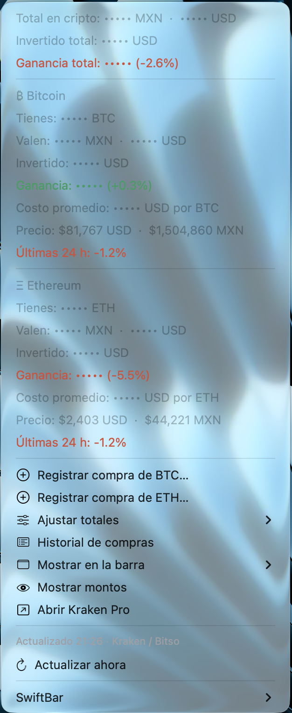

# Barra Cripto MX

Tu BTC, ETH y SOL en la barra de menú del Mac: cuánto tienes, cuánto vale en **pesos mexicanos** y en dólares, tu ganancia y los precios en vivo.

Es un plugin para [SwiftBar](https://github.com/swiftbar/SwiftBar), pensado para quien compra cripto cada semana (DCA) y quiere ver su avance sin abrir el exchange.

## Qué hace

- La barra va rotando entre **el total de tu cripto** y **cada moneda que tienes** (BTC, ETH y SOL), en MXN y con tu ganancia o pérdida (por ejemplo `₿Ξ◎ $21,204 ▲2.3%`).
- El menú muestra, para cada moneda: cuánto tienes, cuánto vale (MXN y USD), cuánto has invertido, tu ganancia, tu costo promedio, el precio y el cambio en 24 h.
- **Registrar compra**: después de cada compra escribes cuánto compraste y cuánto pagaste; se suma a tus totales y se guarda un historial (CSV) que puedes abrir en Numbers o Excel.
- **Ocultar montos**: para cuando compartes pantalla.
- **Sin internet** muestra el último precio guardado, en gris y con la hora.
- Se actualiza cada 30 segundos.

## Requisitos

- macOS 12 (Monterey) o más nuevo.
- [SwiftBar](https://github.com/swiftbar/SwiftBar) (gratis y de código abierto).

## Instalación

1. Instala SwiftBar: descárgalo de [sus releases en GitHub](https://github.com/swiftbar/SwiftBar/releases) o con `brew install swiftbar`.
2. Al abrirlo te pide una carpeta para los plugins: crea una carpeta llamada `SwiftBar` en tu carpeta de inicio y elígela.
3. Descarga [`btc.30s.sh`](btc.30s.sh) y ponlo en esa carpeta. SwiftBar lo activa solo.
4. Haz clic en **₿** en la barra → **Configura cuántos BTC tienes…** (y lo mismo para ETH y SOL, si tienes).

## Uso

| Opción del menú | Para qué sirve |
|---|---|
| Registrar compra → BTC / ETH / SOL… | Sumar una compra (cantidad y USD pagados, con comisión) |
| Ajustar totales → BTC / ETH / SOL… | Corregir tus totales, por ejemplo después de pagar comisión de red al mover a tu wallet |
| Historial de compras | Abrir el CSV con todas tus compras registradas |
| Mostrar en la barra | Rotar (el total y cada moneda), solo el total, solo BTC, o solo precios |
| Ocultar montos | Esconder tus cantidades y valores |

Para cambiar cada cuánto se actualiza, renombra el archivo: `btc.1m.sh` (cada minuto), `btc.5m.sh` (cada 5 minutos), etc.

## Privacidad y seguridad

- **Tus datos se quedan en tu Mac**, en la carpeta oculta `~/.gadget_btc/`. El plugin no los envía a ningún lado.
- Solo hace peticiones públicas de precios. **No usa llaves de API** ni se conecta a tu exchange o tu wallet.
- Es un solo archivo de texto: puedes abrirlo y leer exactamente qué hace antes de instalarlo.

## Fuentes de precios

- Precio en USD: Kraken (API pública).
- Precio en MXN y cambio en 24 h: Bitso (API pública).
- Respaldo si alguna falla: [CoinGecko](https://www.coingecko.com).

El menú indica de dónde salió cada precio. El valor en MXN usa el precio de Bitso, así que puede diferir un poco de convertir el precio en USD con el tipo de cambio oficial.

## Aviso

Esto no es asesoría financiera. Los precios pueden tener retraso o errores. Este proyecto no está afiliado a Kraken, Bitso, CoinGecko ni SwiftBar.

Hecho con ayuda de Claude (Anthropic).

## Licencia

[MIT](LICENSE)
